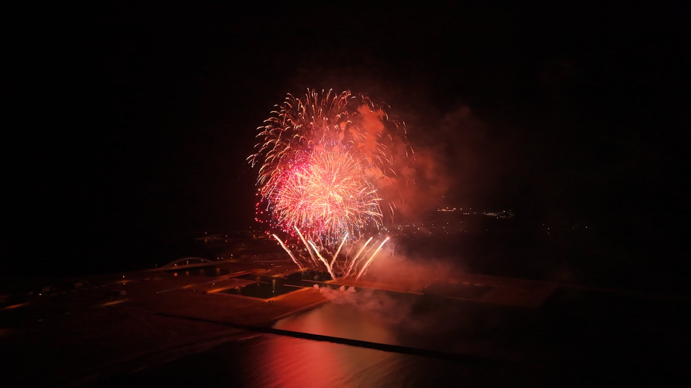
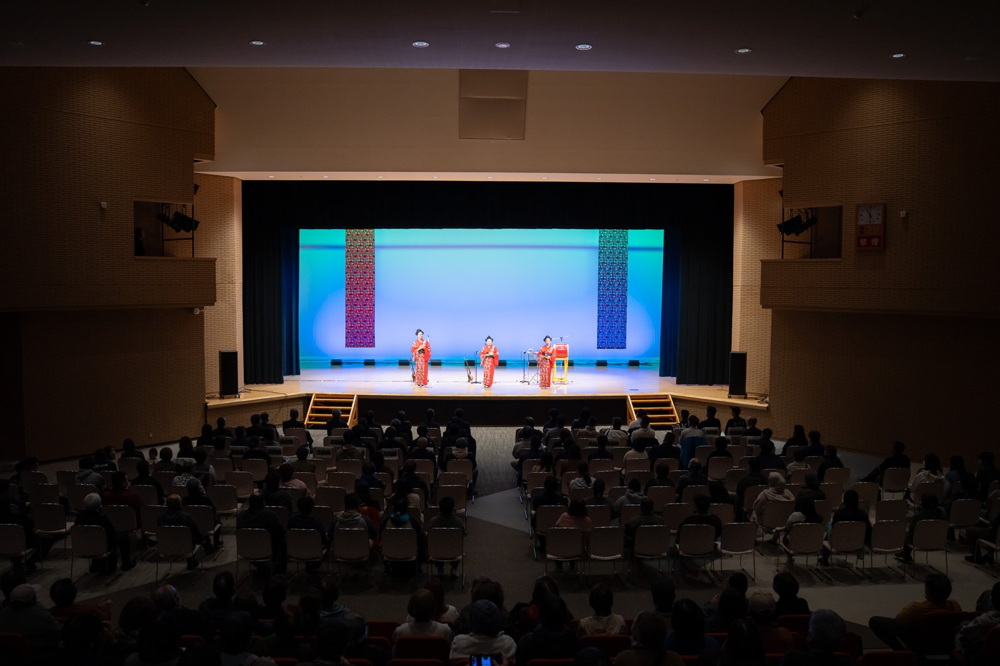
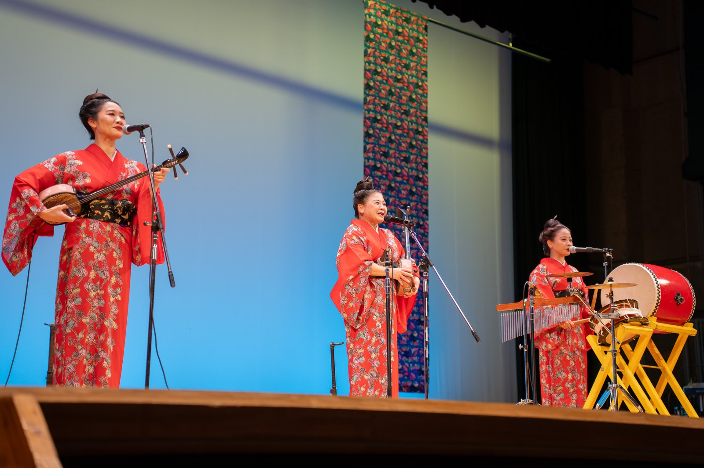

11月2日、浜中町で「はまなか盛りあげ隊」が主催する花火大会があり、その花火をドローンで空から撮影しました。

{{youtube:iAny5XtDiaI}}

[撮影した動画をYouTubeで見る](https://youtu.be/iAny5XtDiaI)

結論から書くと、こうなりました。

- **準備**：何の許可が必要か、どこに相談するか、申請書に何を書くか。ほぼすべてをAIと一緒に進めた
- **AIも間違えた**：申請の大事な数字を一つ間違えて案内され、国からの指摘で気づいた
- **当日**：前日の練習はできず、ぶっつけ本番。さらに想定外が重なったが、離陸してからは問題なく撮影できた

## そもそも、何の許可が必要なのか

ドローンを飛ばすこと自体には、資格はいりません。機体があれば、誰でも飛ばせます。

ただ、花火大会を撮るとなると話は別です。夜に飛ばすこと、人や物から30m未満の距離で飛ばすことには、国の許可・承認が必要です。でも、申請や関係する人たちへの根回しの知識は、正直ありませんでした。

そこで最初に、AIに「花火大会をドローンで撮りたい。何の許可が必要か、何を準備すればいいか教えてほしい」と相談しました。

返ってきたのは、やることの一覧です。国の申請システム（DIPS：ドローンの飛行許可をオンラインで申請する国土交通省の仕組み）での手続き、保険、関係機関への事前相談、当日の体制づくり。最初に全体像がわかったので、何から手をつければいいか迷わずに済みました。

## 申請書づくりは、AIと一緒に一画面ずつ

申請では、これまでの飛行経歴を書く欄があります。これは、パソコンに入っていたドローンの飛行記録をAIに集計してもらいました。総飛行は約23.7時間・174回。手で数えずに、数字で示せました。

申請画面は、スクリーンショット（画面の写真）をAIに送って、「ここは何を入れればいい？」と一つずつ聞きました。文字数に制限がある欄も、「コピペできる形で」と頼むと、そのまま貼れる文章で返ってきます。

飛行する範囲を示す地図も、AIに作ってもらいました。地図に飛行範囲や立入禁止の区画、観客席までの距離を書き込んだ資料で、直しが入るたびに作り直し、最終的に4回目の版まで更新しています。

## 電話の前に「何を聞くか」を決めておく

国への申請とは別に、地元の関係機関にも事前に相談しました。消防、漁協、町役場、海上保安部、警察などです。

ここでもAIに、どこに何を聞けばいいかを整理してもらいました。実際に電話してみると、AIが用意してくれた内容とは違う話になることもありました。それでも、AIがかなり細かく「これを確認して、これを伝えてください」と準備してくれていたので、慌てずに話を進められました。

相談した結果は、こうでした。

- 消防署と町役場：届け出は不要
- 漁協：飛行する時間帯に、湾に船は出ていない
- 海上保安部：船を使わず、港ではなく砂浜から飛ばすなら、申請は不要

電話の前に聞くことを決めておくと、短い時間で確認が終わります。

## AIも間違える。国からの指摘で気づいたこと

申請は一度で通ったわけではなく、国から2回、直すように指摘を受けました。

1回目は「花火大会の上は、催し場所の上空を飛ぶことにあたる」という指摘です。指摘の文章をそのままAIに貼って相談し、申請の項目と理由の文章を直しました。

2回目の指摘で、大事なことに気づきました。**最初にAIが案内した、立入禁止の区画の距離が間違っていた** のです。AIは60mと案内していましたが、飛ぶ高さに応じた正しい距離は70mでした。

AIは間違いを認めて、基準の表を出し直してくれました。それに合わせて区画を広げ、安全対策も見直して、申請を出し直しています。

AIの答えは便利ですが、間違うこともあります。特に大事な数字は、元の資料や窓口で確かめることが欠かせません。

## 当日：練習なしのぶっつけ本番、そしてハプニング

準備の段階では前日の夜に練習するつもりでしたが、結局できず、ぶっつけ本番になりました。

しかも当日は、想定外のことが続きました。

花火の前には、沖縄から来た「ゆいゆいシスターズ」のコンサートがありました。もともと、このコンサートの写真を撮る予定はありませんでした。ところが開演2分前に、写真の担当の人が来ていないことがわかり、急きょ1時間、コンサートの撮影をすることになりました。

コンサートは5時半に始まり、6時半に終わる予定でした。それが押して、終わったのは7時ごろ。そこから急いで、ドローンの離陸場所に向かいました。

いざ離陸しようとすると、今度はドローンが「キャリブレーション（機体の向きなどを正しく測り直す作業）を行ってください」と表示してきました。何度やり直してもうまくいきません。原因は、周りが暗すぎて明るさが足りないことでした。

そこで、車のライトをハイビームにしてドローンを照らしてみると、無事に離陸できました。離陸してからは何の問題もなく、空から花火を撮ることができました。

## まねするなら、どこから始めるか

自分の町のイベントでドローン撮影をしてみたい方へ。

**ドローン自体は、資格がなくても機体があれば誰でも飛ばせます。** ただ、申請や根回しの知識がないと、何をすればいいかわかりません。自分もそうでした。

そんなときは、AIにただ聞くのではなく、**厳しく意見を求める** のが大事です。そのうえで、今回やってみてわかったコツをまとめておきます。

- **最初に全体像を聞く**：何の許可が必要で、どこに相談するかを一覧にしてもらう
- **画面はスクリーンショットで見せる**：説明しなくても、画面を読んで答えてくれる
- **「コピペできる形で」と頼む**：申請書の文章が、そのまま使える形で返ってくる
- **大事な数字は自分で確かめる**：AIも間違える。元の資料や窓口で確認する
- **最後は自分の判断**：許可の条件を守って飛ばすのは、操縦する自分自身

準備にかけた時間は、本番で慌てないための時間でした。AIは、その準備をぐっと速く、確かにしてくれる相棒です。
