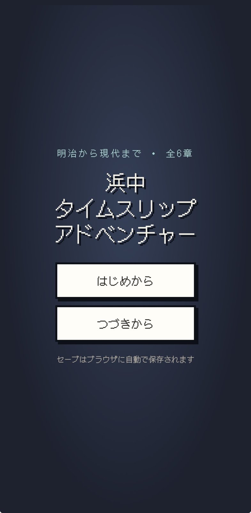
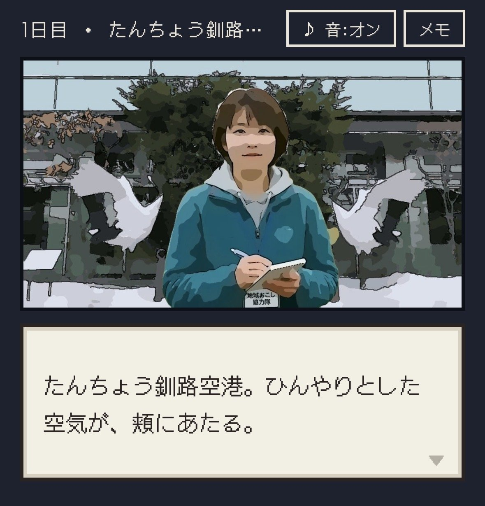
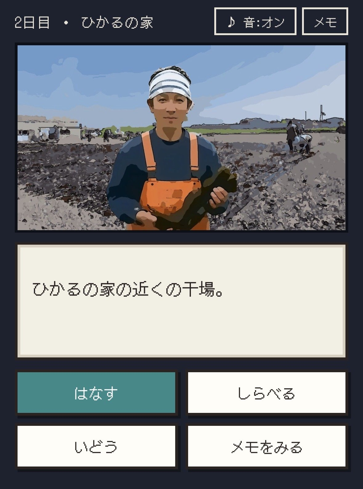
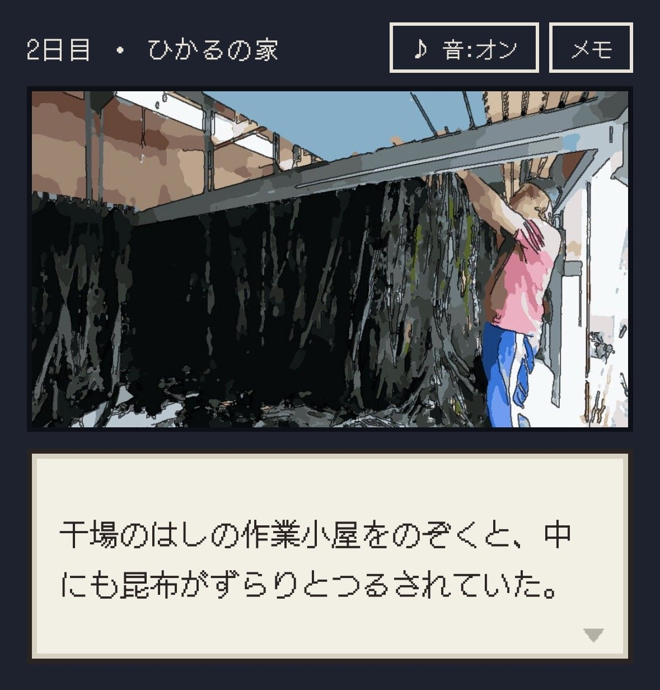

浜中町の歴史を、ゲームで旅しながら学べる。そんなブラウザゲーム **「浜中タイムスリップアドベンチャー」** を、AIと一緒に作っています。

結論から書くと、今はこんな状態です。

- **進み具合**：最後まで遊べるところまで、できあがった。今は背景の素材を整えたり、中身を磨いたりする最後の調整中
- **AIが得意だったこと**：本の写真をまとめて、ゲームの中身（歴史の話）を作り込むこと
- **苦労したこと**：写真や絵などの「素材」を用意すること。AIに何も渡さずに絵を頼むと、チープなものができた

いまの版は、こちらで遊べます。スマホでもパソコンでも、ブラウザだけで動きます。
**[浜中タイムスリップアドベンチャー](https://hamanaka-time-trip.netlify.app/)**

## どんなゲームか

主人公は、都会の人混みに疲れた少年（または少女）です。浜中町に移住して、地域おこし協力隊として移住の相談などの仕事をしている「ひかる」のところへ、1か月の休暇を取ってやってきます。浜中で、少し元気を取り戻すためです。

そこで主人公は、ひかるの仕事の一つである「浜中の歴史の資料をそろえる」手伝いをすることになります。そして、時間を超えて過去の浜中へ。当時の人から話を聞き、資料を持ち帰って、町の歴史を完成させていく。そんな物語です。

舞台は明治から現代までの全6章。「はなす」「しらべる」「いどう」といったコマンドを選んで進めていきます。

## きっかけは、歴史の動画づくり

浜中の歴史を題材にしたのには、きっかけがあります。

もともと、歴史に関する動画を作ることになって、資料を集めてまとめていました。ちょうどその頃、AIでいろいろなゲームを作っていたこともあって、ふと思ったのです。「この歴史がわかる、面白いゲームがあったら面白いよな」と。

AIで作った最初のゲーム「[ラッコのぷかぷか大冒険](/posts/rakko-pukapuka-game/)」など、ゲームづくりの経験がこの企画につながりました。

## 中身づくりは、本の写真から

歴史の中身を作るときは、AIがとても役に立ちました。

町の歴史が書かれた本を写真に撮って、それをAIにまとめてもらう。その内容をもとに、ゲームの中の会話や出来事を作り込んでいきます。この部分は、AIを使ってかなりスムーズに進めることができました。

## 苦労したのは「素材」の用意

一方で、思った以上に大変だったのが、素材の用意です。ゲームでも動画でも同じですが、作るには写真や動画、絵といった素材がたくさん必要になります。

AIに頼んでうまくいかなかったのが、人物や背景の絵です。最初、参考になる写真などを何も渡さずにAIに作ってもらったところ、なんだかチープなものができあがってしまいました。微妙で、変なデザインになってしまうこともありました。

そこから、背景やキャラクターを試行錯誤しながら作り直していきました。少しずつ、少しずつ、良くなっていったという感じです。今のゲームの画面は、実際の写真を、イラストのような雰囲気に加工して使っています。

## 完成したら、どう使いたいか

このゲームの使い道として、考えていることがあります。

- **町の教材として**：遊びながら、町の歴史にふれてもらう
- **町の外の人に向けて**：浜中に興味がある人や、遊びに来た人に、歴史という新しい一面を知ってもらう
- **ほかの町でも**：このゲームをもとに、それぞれの市町村の歴史がわかる面白いゲームを作る

浜中だけでなく、いろいろな町の歴史をゲームにしていく。それも、今後の仕事の一つになるのではと考えています。

## AIでゲームを作ってみたい人へ

AIでゲームを作るのは、思っているより簡単です。凝ったものでなければ、「こういうゲームを作りたい。足りないことを教えて」と伝えるだけで大丈夫です。AIのほうから「これはどうしますか？」「あれはどうしますか？」と一つずつ質問してくれるので、それに答えていけばゲームはできあがります。

ただし、ゲームの中身をどうしたいのかは、作る人がちゃんと考えを持って伝える必要があります。そこがないと、どこかで見たような、ありきたりなゲームになってしまいます。

**作るのはAIに任せられる。でも、何を作りたいかという企画は、自分でしっかり考える。** それが、AIと一緒にものづくりをするときのコツだと思います。
