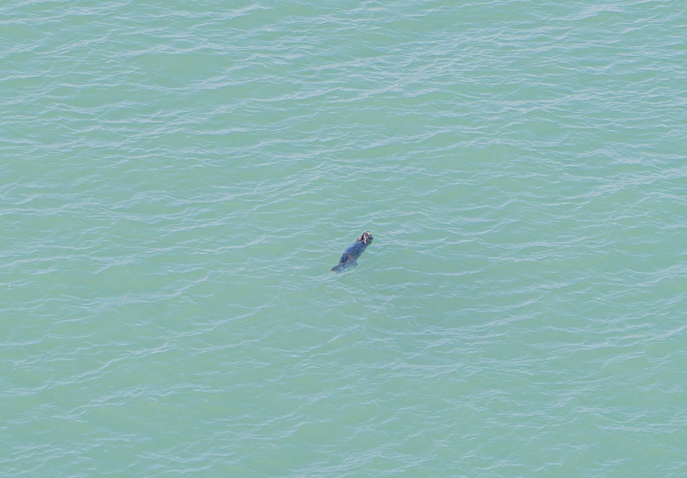
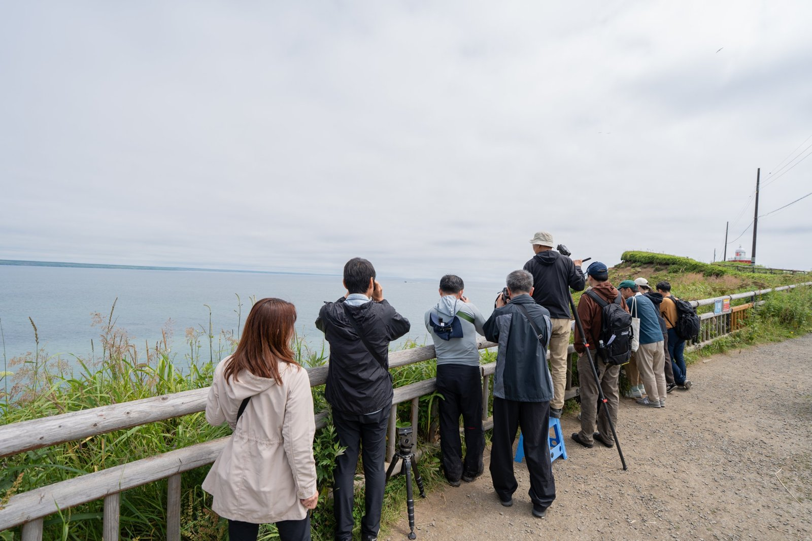
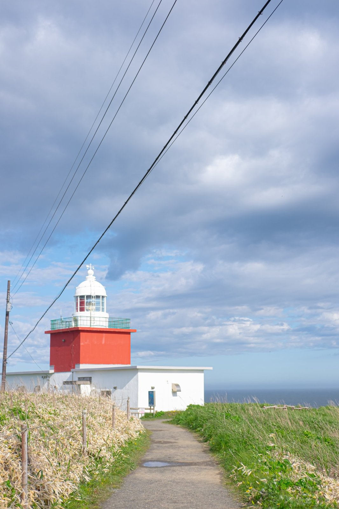

北海道・浜中町の海には、野生のラッコが暮らしています。

結論から書くと、浜中でラッコを見るコツはこうです。

- **場所**：霧多布岬か、アゼチの岬
- **時期**：ラッコは一年中見られる。観光も楽しむなら、5月から9月がおすすめ
- **時間帯**：ご飯の時間の朝と夕方は、見られることが多いと聞く
- **持ち物**：双眼鏡があると確実。持っていなくても、霧多布湿原センターで借りられる
- **注意**：霧多布岬とアゼチの岬では、ラッコがいるため、ドローンを飛ばすことはできない

## 初めて見たラッコは「豆粒」だった

浜中に移住してすぐ、去年の4月に、初めてラッコを見ました。場所は霧多布岬です。

正直に言うと、遠すぎてよくわかりませんでした。海の上に豆粒みたいなものが浮いていて、「あれがラッコなんだ」という感じです。

その後、双眼鏡を使って見て、ようやく「あ、ラッコだ」とはっきりわかりました。

岬の上から海を見下ろす形になるので、ラッコをすぐ近くで見ることはできません。だからこそ、双眼鏡が大事になります。

## ラッコが見られる2つの岬

### 霧多布岬

浜中でラッコを見るなら、まずはここです。岬の先には、赤と白の灯台が立っています。灯台まで続く遊歩道を歩きながら、海に浮かぶラッコを探します。

### アゼチの岬

もう一つのおすすめが、アゼチの岬です。目の前に島が浮かぶ、見晴らしのいい場所です。

※この空からの写真は、ドローンの規制がかかる前に撮影したものです。今はラッコがいるため、アゼチの岬ではドローンを飛ばすことはできません。

## 見に行く前に知っておきたいこと

**一年中、見られる**
ラッコ自体は、一年を通して見ることができます。

**朝と夕方がねらい目**
特に見やすい時間帯があるわけではありません。ただ、朝と夕方はラッコのご飯の時間なので、見られることが多いとよく聞きます。だいたい8割くらいの確率で見られるそうです。

**双眼鏡は借りられる**
双眼鏡は、霧多布湿原センターでレンタルできます。持っていなくても、最悪なんとかなります。

**おすすめは5月から9月**
見やすい季節が特にあるわけではありません。ただ、秋から春にかけてはかなり寒く、岬は風も強くなります。緑が生い茂って、花がたくさん咲く夏の時期が、一番見やすいと思います。霧多布湿原にも花が咲くので、浜中の観光も一緒に楽しむなら、5月から9月がおすすめです。

## ドローンは飛ばせません

ドローンで空からの景色を撮りたい方も多いと思いますが、注意が必要です。**霧多布岬とアゼチの岬では、ラッコがいるため、ドローンを飛ばすことはできません。** 野生のラッコが安心して暮らせるよう、ルールを守って楽しんでください。

## おまけ：夏の朝は、昆布漁の出漁も

アゼチの岬では、7月から10月の朝5時ごろ、漁があれば、昆布漁の船がいっせいに沖へ出ていく様子が見られます。

※この写真も、ドローンの規制がかかる前に撮影したものです。

早起きして岬へ行けば、ラッコと昆布漁、浜中らしい朝の景色を一度に楽しめるかもしれません。
