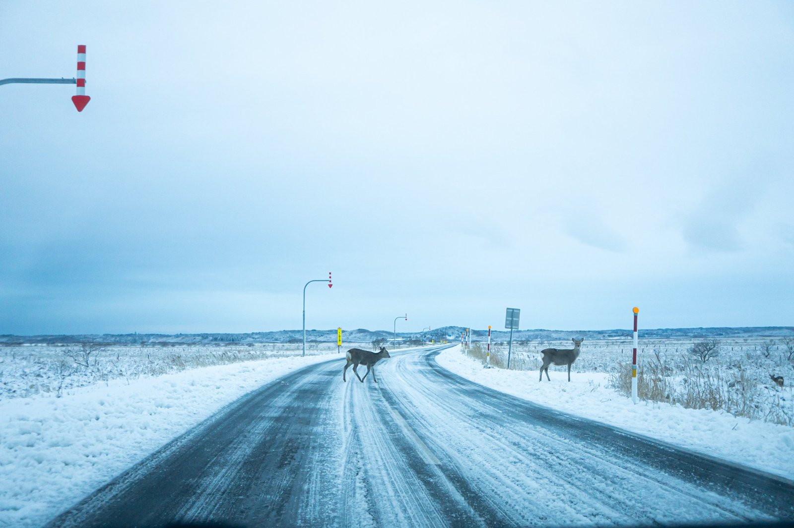
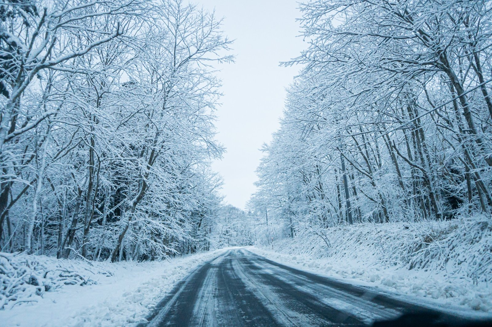
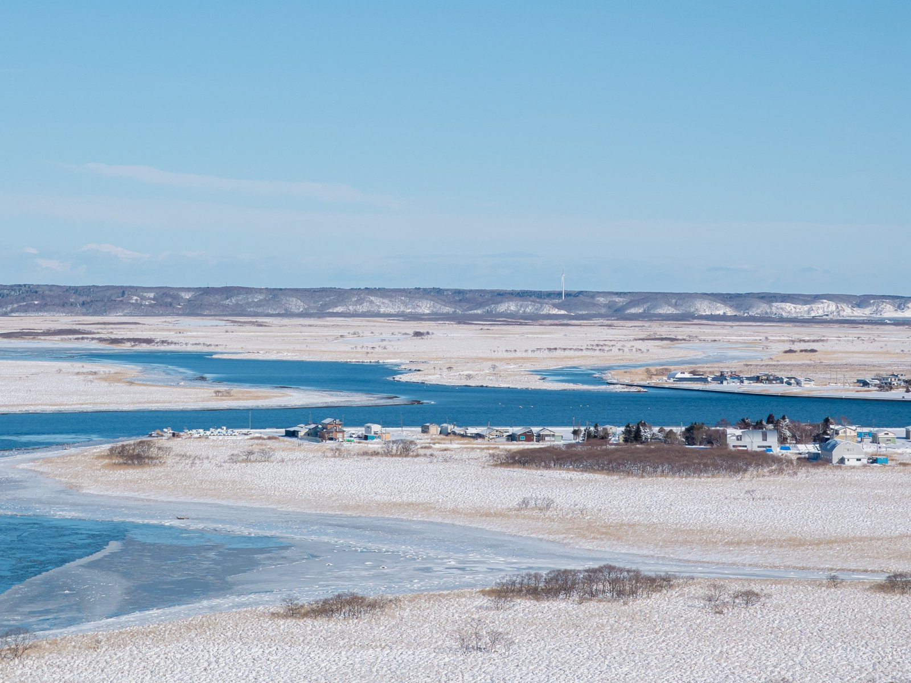
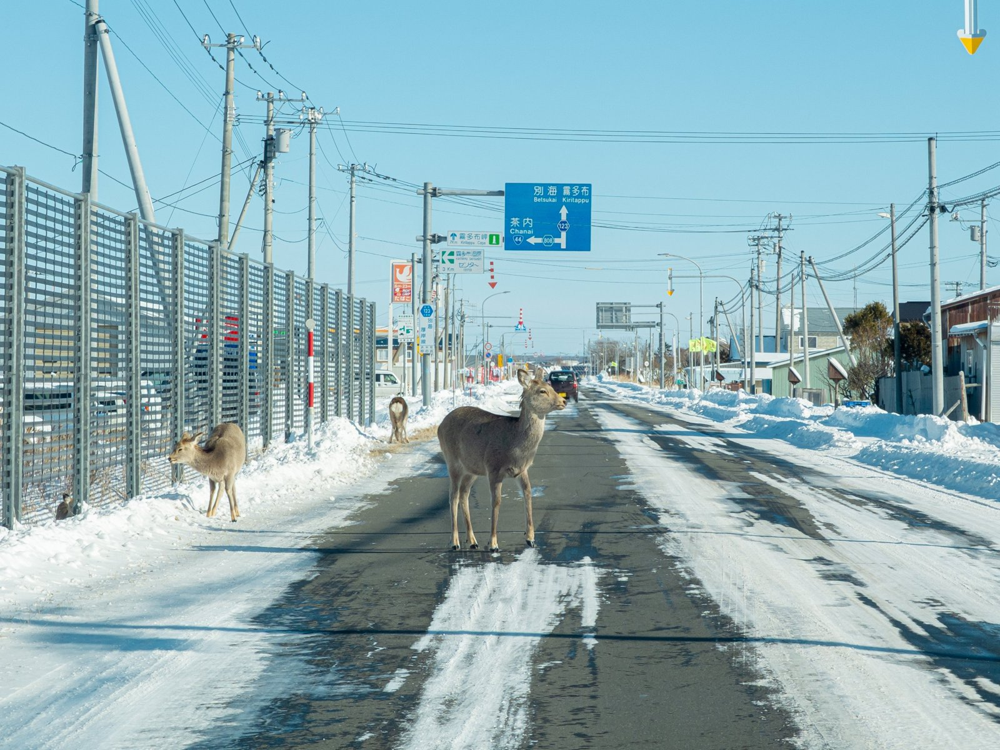
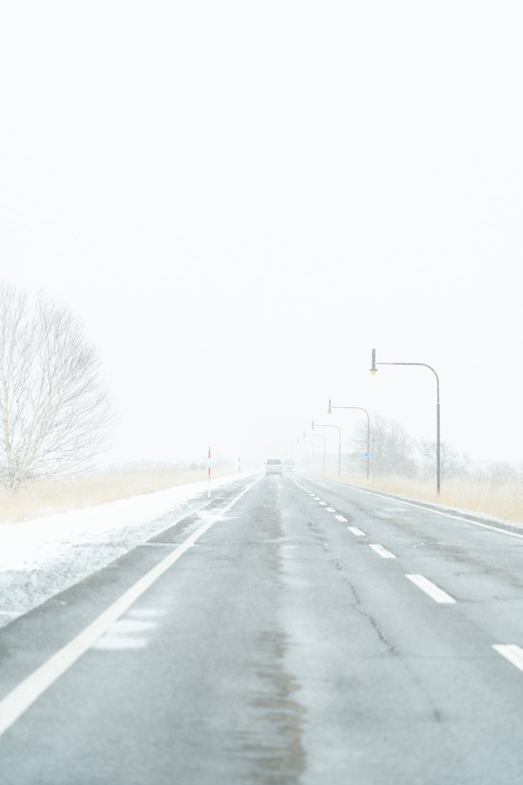

北海道・浜中町に住んで、2回目の冬が近づいてきました。

結論から書くと、浜中の冬じたくで感じていることはこうです。

- **やったこと**：灯油を買ってきた。タンスからダウンジャケットなどの冬服を出した
- **これから**：タイヤ交換
- **意外だったこと**：思ったより雪は降らない。雪かきはそこまで心配していない
- **一番怖いこと**：凍った道と、夜道で飛び出してくるエゾジカ

※この記事の写真は、去年の12月から1月にかけて撮ったものです。

## 冬じたくは、灯油と冬服から

冬が来る前にやったのは、灯油を買ってきたことと、冬服を出したことです。タンスから、ダウンジャケットなどを引っ張り出しました。

車のタイヤ交換は、これからです。

北海道の冬じたくというと、雪かきの道具をそろえる場面を想像する人も多いと思います。でも浜中は、雪がそんなに積もりません。なので雪かきについては、そこまで心配していません。

## 思ったより、雪は降らない

住んでみて一番感じたのは、「思ったより雪は降らないんだな」ということです。

もちろん、雪の日はあります。木々が真っ白になる日もあります。それでも、雪に埋もれて身動きが取れない、というイメージとは違いました。

浜中に来る前は、福島県の郡山市に住んでいました。郡山も、寒いけれど雪はそれほど降らず、そのかわり道路の凍結が目立つ場所でした。浜中の冬は、その郡山とも、また違うと感じています。

## 一番怖いのは、夜道のエゾジカ

浜中の冬で、一番怖いと思ったのは、エゾジカです。

道東には、エゾジカがとてもたくさんいます。昼間でも、こんなふうに道路の真ん中に立っていることがあります。

昼間なら、まだ見えます。怖いのは夜です。

- 夜は暗くて、シカが見えない
- 雪が降ると、降っている雪で前が見えにくくなる
- 霧が出ると、霧で前が見えなくなる

暗さに、雪や霧が重なる。そのうえ、シカがいつ飛び出してくるかわからない。これが浜中の冬の道です。

## 冬の運転で、気をつけていること

そこで、冬の運転では、次のことを気をつけています。

- **夜は、なるべく出かけない**
- **朝の早い時間も、避ける**
- **スピードを落として、ゆっくり走る**

スピードを落とす理由は2つあります。一つは、どこが凍っているかわからないこと。もう一つは、シカが急に出てきたときに、スピードが出ていると止まれないことです。

## 北海道も「夕方から夜」に注意を呼びかけている

調べてみると、北海道庁も、エゾジカとの交通事故に注意を呼びかけていました。北海道庁のページによると、こうした事故は次の時期・時間に多いそうです。

- **時期**：1年間の事故のおよそ4割が、10月から11月に起きている。シカの動きが活発になり、冬を越す場所へ移動する時期と重なるため
- **時間**：7割以上が、16時から24時の間に起きている

つまり、ちょうど今の時期の、夕方から夜が一番危ないということです。

北海道庁のページでは、ほかにも次のような注意点が挙げられています。

- 夜、ヘッドライトに照らされて目が光るものがあれば、シカかもしれない
- 1頭が道路を渡ったあとも、2頭目、3頭目が飛び出してくることがある

1枚目の写真でも、1頭が道路を渡っている横に、もう1頭が立っていました。1頭見かけたら、まだ近くにいると思って走るのがよさそうです。

## これから冬の道東に来る人へ

道東の冬は、雪の量だけを見ると、思っているほど大変ではないかもしれません。でも、凍った道と、シカの飛び出しには、本当に気をつけてほしいと思います。

冬に道東を車で走るときは、

- 暗くなる前に移動を終える予定を立てる
- スピードを落として、ゆっくり走る
- シカを1頭見たら、ほかにもいると思って走る

この3つを意識するだけでも、だいぶ違うはずです。

晴れた日の雪景色は、本当にきれいです。安全に気をつけながら、道東の冬を楽しんでください。

出典：[北海道庁「エゾシカが関係する交通事故」](https://www.pref.hokkaido.lg.jp/ks/skn/est/ht/traffic_accident.html)
