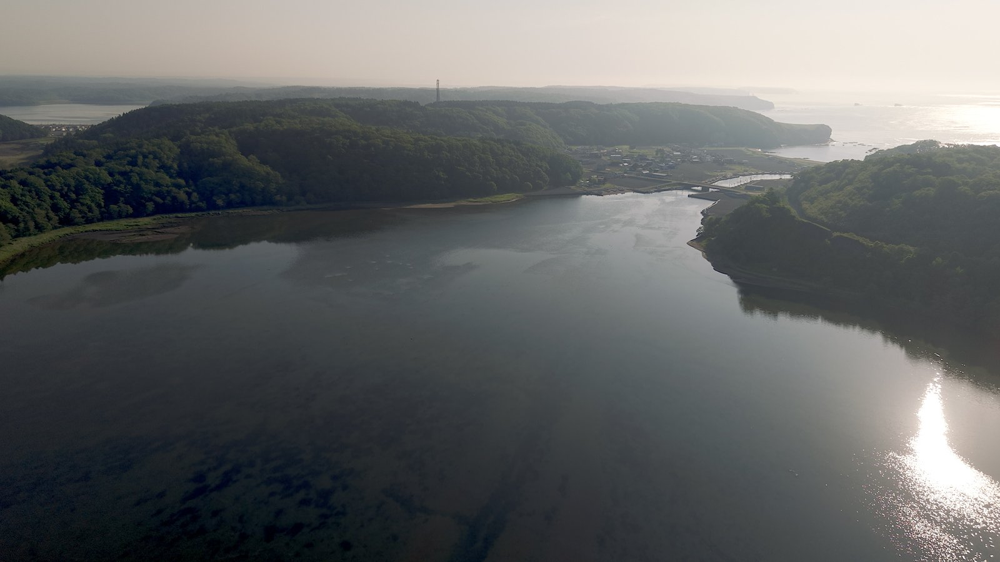

北海道・浜中町には、ラッコが見られる霧多布岬やアゼチの岬のほかにも、見てほしい場所がたくさんあります。

今回は、浜中で見てきた場所の中から5つを、まとめて紹介します。

結論から書くと、この5つです。

- **霧多布湿原**：「花の湿原」と呼ばれる、日本で4番目に大きな湿原。見頃は6月から7月
- **琵琶瀬展望台**：陸から霧多布湿原が一番きれいに見える場所。湿原の緑と海の青が両方見える
- **嶮暮帰島（けんぼっきとう）**：ムツゴロウさんが暮らしたことで知られる無人島
- **藻散布沼（もちりっぷぬま）**：映画『思い出のマーニー』のモチーフになったと言われる沼
- **涙岬**：悲しい伝説が残る断崖の岬。初めて見たとき、本当に感動した場所

## 1. 霧多布湿原：「花の湿原」と呼ばれる湿原

霧多布湿原は、日本で4番目に大きな湿原です。花がとても多いことから、「花の湿原」とも呼ばれています。一番の見頃は、6月から7月にかけてです。

咲く花の種類はとても多く、地元のNPO法人がまとめた資料では、湿原を含む浜中町で、約790種の植物（花やシダなど）が記録されています。

その中でも人気なのは、黄色い花のエゾカンゾウと、白い綿毛がかわいいワタスゲです。

ただ、エゾカンゾウは、ここ数年でずいぶん少なくなってしまいました。エゾシカがかなり増えて、エゾカンゾウを食べてしまったようです。今は、もうほとんど数本しか咲いていません。

## 2. 琵琶瀬展望台：湿原の緑と、海の青

霧多布湿原を見るなら、琵琶瀬（びわせ）展望台がおすすめです。陸から見るなら、ここから見る霧多布湿原が一番きれいだと思います。

湿原側だけでなく、反対側の景色も見どころです。展望台の反対側には、崖があって、その先に海が広がっています。

湿原側は緑、海側は青。この対照的な色の違いが、自分は一番好きです。

## 3. 嶮暮帰島：ムツゴロウさんが暮らした無人島

嶮暮帰島（けんぼっきとう）は、浜中町にある無人島です。

昔は、漁師さんが取ってきた昆布を、この島で干していたそうです。そして、動物とのふれあいで知られる「ムツゴロウさん」が暮らし、ムツゴロウ動物王国がもともとあった場所が、この嶮暮帰島です。

今は、基本的に島へ行くことはできません。渡り鳥がやってきて、水鳥などが子育てをする場所になっていて、国からも貴重な場所だと認められています。

## 4. 藻散布沼：ぱっと見は「よくわからない」沼

藻散布沼（もちりっぷぬま）は、正直に言うと、ぱっと見ただけではよくわからない、静かな沼です。

でも実は、スタジオジブリの映画『思い出のマーニー』のモチーフになったと言われている沼です。
## 5. 涙岬：初めて見たとき、思わず感動した

涙岬（なみだみさき）は、浜中町の中でも少し離れた、厚岸町との町境に近い場所にあります。

駐車場に車を止めてから、岬まではおよそ10分歩きます。たどり着くと、そこは断崖絶壁。下をのぞくと、波が打ちつけているのが見えます。

涙岬そのものも、本当に圧巻です。自分は初めて見たとき、「わ、すごいな」と感動しました。

### 涙岬の伝説

涙岬には、名前のもとになった伝説が残っています。

ニシン漁がさかんだったころ、厚岸（あっけし）の若者が、嵐にあって命を落としてしまいました。その若者を想い続けた娘が、やがて岩になったと伝えられています。

岬には、泣いている女性の横顔のように見える岩があり、「乙女の涙」とも呼ばれています。

## 浜中に来るなら

霧多布湿原の花を見るなら、6月から7月がねらい目です。嶮暮帰島には渡れないこと、涙岬は駐車場から10分ほど歩くことも、覚えておいてください。

ラッコが見られる霧多布岬とアゼチの岬は、「[浜中で野生のラッコに会う。霧多布岬とアゼチの岬、見るためのコツ](/posts/hamanaka-sea-otter/)」で紹介しています。あわせて回れば、浜中の海と湿原を、たっぷり楽しめると思います。

出典：
- 植物の数、湿原の大きさ：特定非営利活動法人 霧多布湿原ナショナルトラスト『霧多布湿原 生きものリスト2018』
- 「花の湿原」の呼び名：[環境省「霧多布湿原」ラムサール条約湿地パンフレット](https://www.env.go.jp/nature/ramsar/conv/ramsarleaflet/10_Kiritappu-shitsugen.pdf)
- 涙岬の伝説：[北海道公式観光サイト HOKKAIDO LOVE!「涙岬」](https://www.visit-hokkaido.jp/spot/detail_10472.html)
