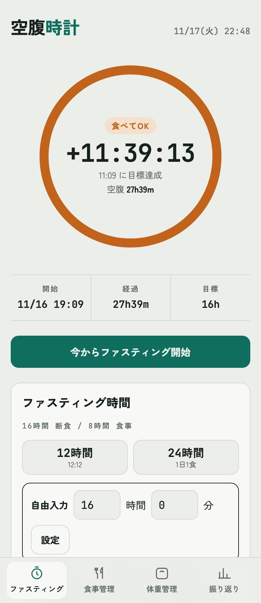
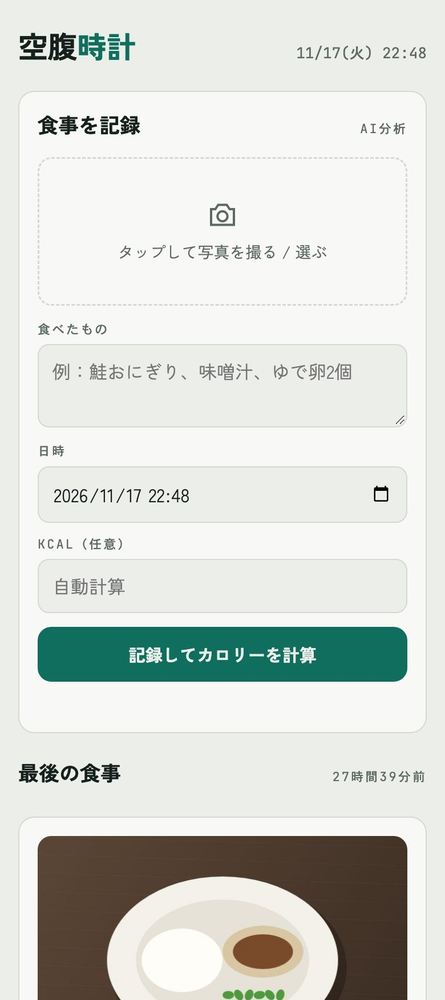
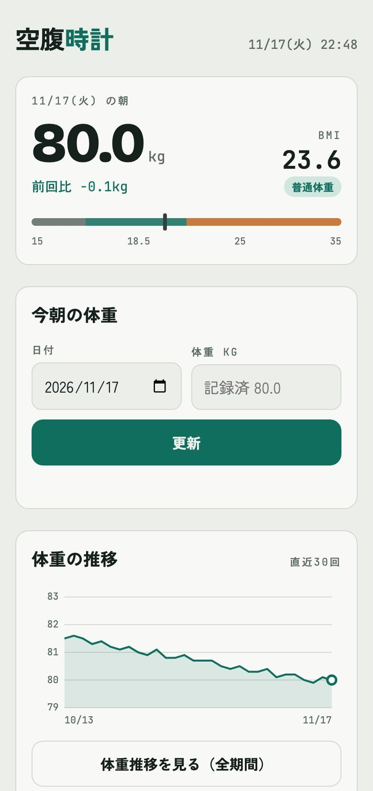
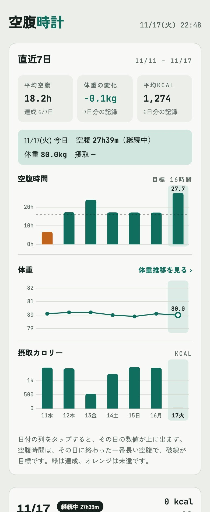
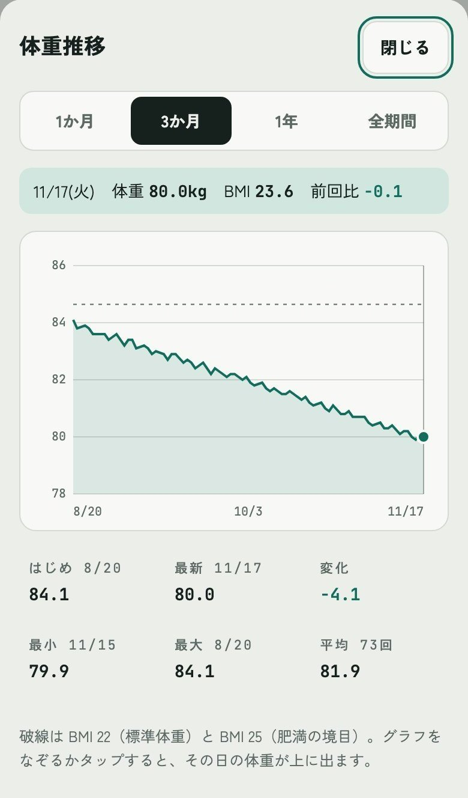

食事と体重を記録して「見える化」する、自分用のアプリを作りました。名前は「空腹時計」です。

結論から書くと、こんなアプリになりました。

- **できること**：ファスティング（食事をとらない時間をつくること）の残り時間の表示、食事の記録とカロリー計算、毎朝の体重の記録、1週間の振り返り
- **便利なところ**：写真を撮るだけで、AIがカロリーを計算して、次の食事のアドバイスまでくれる
- **かかった時間**：2時間ほど。そのうち半分は、修正と追加
- **費用**：追加の料金はかかっていない

※この記事の画面は、デモ用の画面です。体重や食事などの数字は、すべて架空のデータです。

## きっかけは「また少しずつ増えてきた」

一度体重を落としてから、しばらくたって、また少しずつ体重が増えてきていました。

自分の体重管理のために、毎日どんなものを食べているのか、体重がどんなふうに落ちていくのか。そういうデータを残しておきたい。そして、それを見える化したい。そう思いました。

ファスティングや体重、食事を記録するアプリは、ほかにもたくさんあります。実際に、いろいろ見てきました。

でも、市販のアプリだと、自分には無駄な機能が多かったり、逆に足りないものが多すぎたり、画面がごちゃごちゃしていたり。ファスティング、体重、食事をそれぞれ別のアプリで記録しなければならず、1つではなく何個ものアプリを使い分けていたこともありました。

それなら、本当に自分に必要な機能だけがあるアプリを作ろう。そう思って、自分で作ることにしました。

## 4つの画面でできること

アプリは、下の4つのタブで切り替えて使います。

### 1. ファスティング

次に食べてもいい時刻まで、あとどれくらいかを、円の形のゲージで表示します。時間は「12時間」「24時間」、または自由に入力できます（デモ画面では、自由入力で16時間にしています）。

### 2. 食事管理

食事の写真を撮るか、食べたものを文字で入れると、AIのClaude（クロード）が料理名やカロリー、栄養のバランスを出してくれます。次の食事へのアドバイスもくれます。

### 3. 体重管理

毎朝の体重を入れると、前回からの増減や、BMI（体重と身長から出す、体格の目安）を表示します。

### 4. 振り返り

直近7日の空腹時間・体重・食べたカロリーを、3つのグラフで並べて見られます。

記録は、Googleスプレッドシート（Googleの表計算サービス）にも自動で1行ずつ残るようにしました。

## 使ってみて便利だったこと

一番よかったのは、全部が見える化されることです。見るだけで、「あ、今はこんな感じなんだ」とわかります。

それから、AIのClaudeとつないでいるので、写真を撮ったらカロリーを計算してくれる。食事のメニューから、「次はこういう食事のほうがいいですよ」とアドバイスをもらえる。このあたりは、結構便利でした。

## 時間がかかったのは「自分に合わせる」ところ

作るのにかかった時間は、2時間ほどです。ただ、その半分くらいは、修正と追加に使っていました。

最初は、わりとシンプルな作りでした。そこから、自分の使い方に合わせて、1つずつ直していきました。

**ファスティングの時間をしぼる**
自分は12時間か24時間しかやらないので、選べる時間を12時間と24時間（と自由入力）にしてもらいました。

**ボタンを押さなくていいようにする**
もともとは、ファスティングを始めるときに、自分でボタンを押す必要がありました。それが面倒だったので、食事を登録したら、その時刻から自動でファスティングが始まるようにしてもらいました。

**体重を長い期間で見られるようにする**
その日の体重だけが出ても困るので、過去3か月や1年までさかのぼって推移が見られるグラフを、別のページで作ってもらいました。

こうした追加や修正を、一つひとつやっていたところに、時間がかかりました。

## 費用は、追加の料金なし

このアプリは、claude.ai（AIのClaudeを使うためのサイト）の中で動く、小さなWebページとして作っています。そのため、使っているプランの範囲で動いていて、追加の料金はかかっていません。

Googleのしくみを使って、別の形で作ることも考えました。ただ、その場合はAIの利用料が月300〜600円ほどかかりそうだったので、今の形のまま使うことにしました。

## まねしてみたい人へ

最初から完璧なものを作ろうとしなくて大丈夫です。まずはシンプルに作ってもらって、使いながら「ここが面倒」「これがほしい」と思ったところを、1つずつAIに頼んで直していく。

自分の場合は、その直していく時間が、全体の半分くらいでした。
