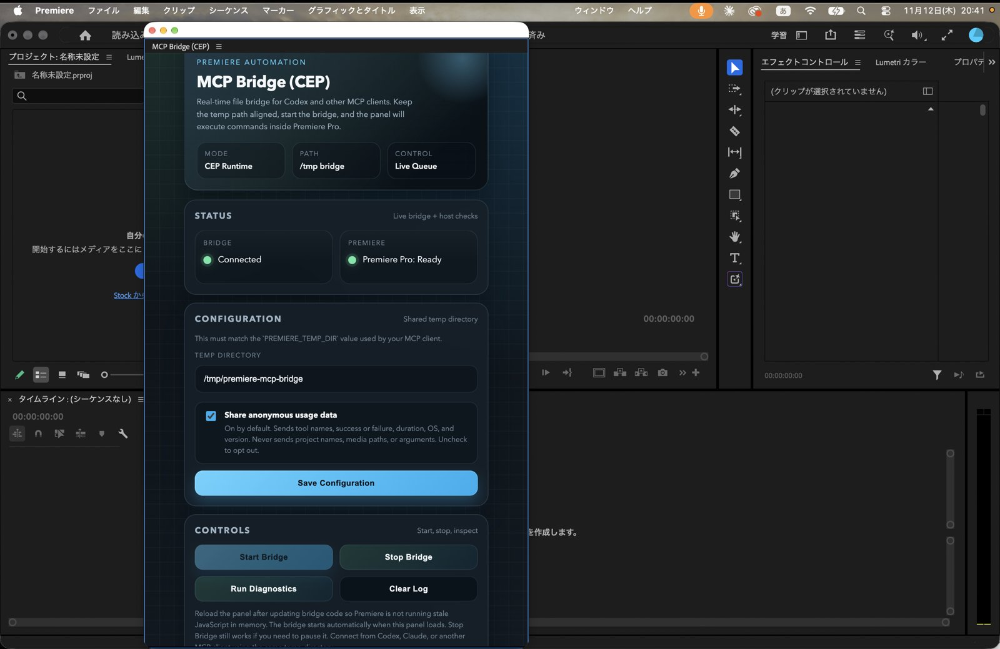
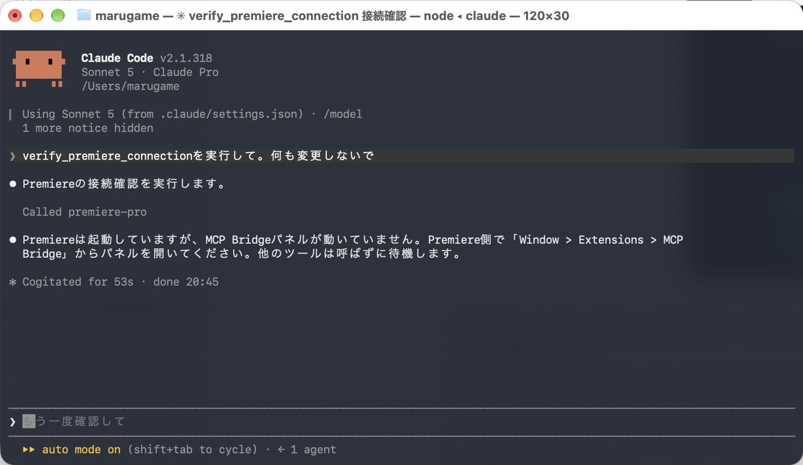
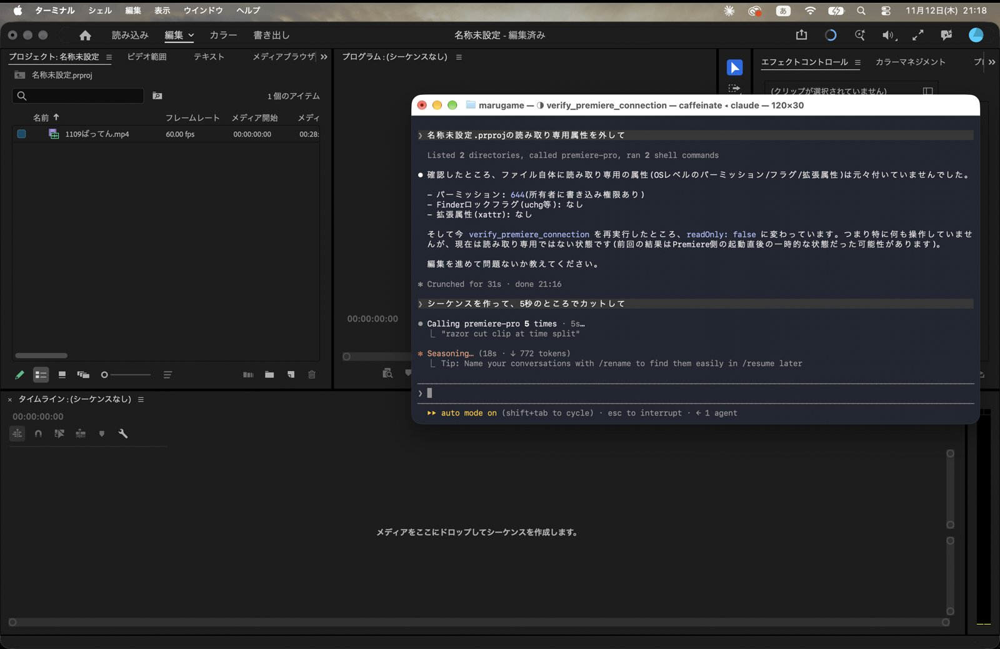
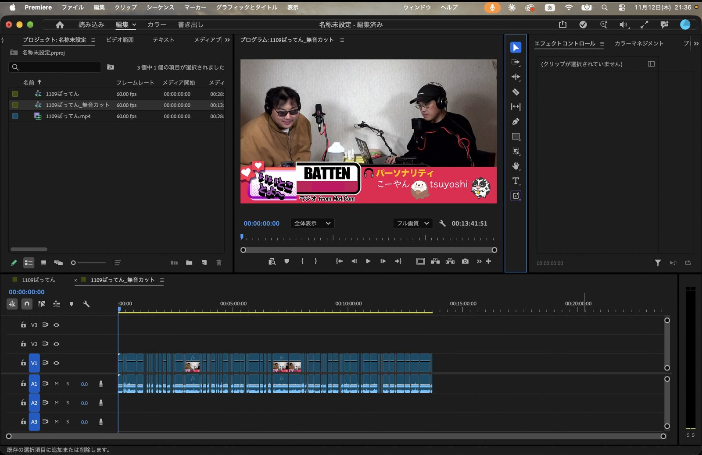

[以前の記事](/posts/resolve-ai-editing/)で、動画編集ソフトのDaVinci Resolve（ダヴィンチ・リゾルブ）をAIに操作してもらった話を書きました。

今回はその続きです。ふだんから使っている編集ソフト、Premiere Pro（プレミア・プロ：アドビの動画編集ソフト）でも、AIに編集をやってもらいました。

結論から書くと、今はこんな状況です。

- **できるようになったこと**：無音のカット、テロップ入れ、ショート動画づくり、音量の調整、音声の同期は、ほぼAIにお任せ。つなぎ言葉のカットや、字幕のフォントの変更もやってもらった
- **まだ足りないこと**：効果音、話の内容に合った素材の差し込み、話している人ごとのテロップの色分け、顔の追従
- **かかった時間**：自分でやると1時間ぐらいかかっていそうな作業が、10分もかからず終わっている感覚
- **費用**：Claude（AIのサービス）の有料プランだけ。それ以外は特にかかっていない

実際に使える段階にはなりました。ただ、まだ自分で手を加えないといけない編集になってしまう、というのが今の正直なところです。

## いつも使っているソフトだから、扱いやすかった

DaVinci Resolveに続いて、Premiere Proでも試しました。

AIにPremiere Proを操作してもらうには、MCP（AIとほかのソフトをつなぐための仕組み）が必要です。今回は、個人の方が作って公開しているPremiere Pro用のMCPを使わせてもらいました。その設定をしたうえで、チャットで指示するとPremiere Proが動くように調整した、という流れだったと記憶しています。

Premiere Proの中に、AIとつなぐためのパネルを開いた画面です。「Connected（つながった）」「Ready（準備OK）」と表示されています。

こちらは、AIに「つながっているか確認して。何も変更しないで」と頼んだときの画面です。このときは「パネルが動いていないので、開いてください」と返ってきました。こんなふうに、AIとやりとりしながら設定を進めていきます。

使ってみて感じたのは、扱いやすさです。

DaVinci Resolveと違って、Premiere Proは基本的にいつも使っているソフトです。だから扱いやすかったし、見やすかったです。

## これまでの試行錯誤が、ここで生きた

設定や、AIを「育てる」ところ（自分の編集に合わせて調整していくこと）は、わりと簡単にできてきたかな、という感じです。

というのも、これまでDaVinci Resolveでも、自分で作っている[ショート動画を自動で作るアプリ](/posts/auto-shorts-app/)でも、いろいろと試行錯誤してきたからです。その経験があったので、Premiere Proでは前ほど苦労しませんでした。

## AIにやってもらっている作業

今、Premiere Proでやってもらっているのは、次の作業です。

- 無音のカット（話していない間を切る）
- テロップ入れ
- ショート動画（スマホで見る縦長の短い動画）づくり
- 音量の調整
- 音声の同期（別々に録った音声と映像のタイミングを合わせる）
- つなぎ言葉のカット（「えー」「あのー」などを切る）
- 字幕のフォントの変更

このうち、無音のカットから音声の同期までは、ほぼ完全にAIにやってもらっています。

指示は、チャットに文章で書くだけです。この画面では「シーケンスを作って、5秒のところでカットして」と頼んでいます。

ラジオ番組の収録動画で、無音のカットをやってもらった後のタイムライン（動画を時間の順に並べて編集する場所）です。話していない部分が切られて、細かいクリップが並んでいます。

## まだ足りないところ

一方で、細かいところはまだまだです。

効果音を入れること。話している内容に合った素材を、その場面に入れること。話している人ごとに、テロップの色を分けること。話している人の顔の追従（顔の動きに合わせて画面を動かすこと）。

このあたりはまだ足りていません。実用はできるものの、AIが編集したものに、まだ自分の手を加えないといけないのが現状です。

足りないところが多いので、これから育てていく必要があると感じています。

## 時間と費用

費用は、特にかかっていません。使っているのはClaudeの有料プランだけです。

作業時間は、まだ一回とりあえず教え込ませている段階なので、はっきりとは言えません。それでも、気づいたら1時間ぐらいかかっていたような作業が、10分もかかってないぐらいで終わっているんじゃないかな、という感覚です。

## 動画編集にAIを使ってみたい人へ

自分の場合は、ふだん使っているPremiere Proだったので、扱いやすく、見やすかったです。そして、DaVinci Resolveやショート動画のアプリで試行錯誤していた分、Premiere Proの設定はわりと簡単に進みました。

一回で完成するものではなく、試しては直して、育てていくもの。今はまだその途中です。
